# 文件小游戏 · dsh-together

<div align="center">

**每次改文件之前，先玩一局小游戏。**

一个 DeepSeek Harness 插件：Agent 想写文件时，宿主把它按在门口，浏览器里弹出一局小游戏；
你过关，Agent 才继续。**194 个小游戏**、10 个分类、真正的不重复抽题、还带一个测试放行后门。

[功能](#功能) · [截图](#截图) · [安装](#安装) · [设置](#设置) · [游戏库](#游戏库) · [原理](#原理) · [开发](#开发)

</div>

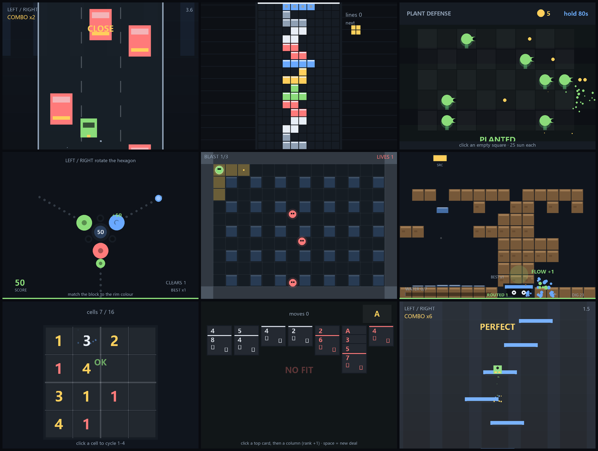

---

## 功能

| | |
|---|---|
| 🎮 **194 个小游戏** | 经典街机、跑酷、益智、手速、文字、棋牌、节奏、物理、**立体 3D**、**复古手机** |
| 🚧 **真拦截，不是装饰** | 挂在 `tools/pre-execute` 上，文件类工具调用会**真的等你**（异步等待，不是报错） |
| 🔁 **不会连续两次同一个** | 最近的游戏会被记入轮换池并持久化，重启后照样生效 |
| 🌍 **跟随界面语言** | 中文/英文自动切换，每个游戏都有一行玩法说明 |
| 🎯 **门槛分级** | 宽松 / 标准 / 严格，只改倍率，不会让游戏变成不可完成 |
| 🧪 **测试放行后门** | 一局实在过不去就一键放行（不记分、不产生冷却），永不把人卡死 |
| 🧊 **3D 无需三方库** | 自带紧凑 WebGL1 渲染层，14 个 3D 游戏零依赖运行 |
| 💤 **离开就暂停** | 切到别的标签页时本局计时暂停，不白烧时限 |

## 截图

真实画面（由游戏自身的绘制调用离线光栅化而来，不是示意图）：

| 躲车流 | 俄罗斯方块 | 植物防守 |
|---|---|---|
| 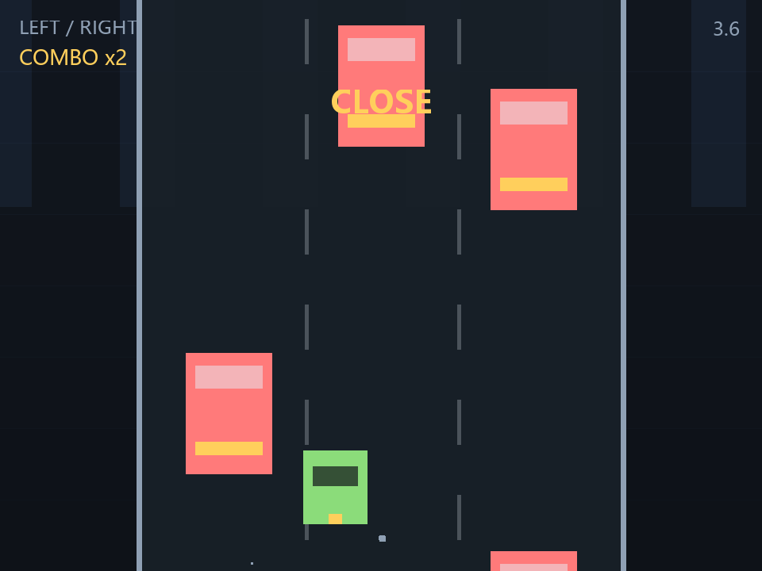 | 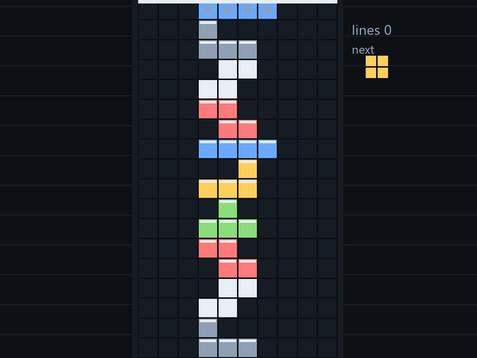 | 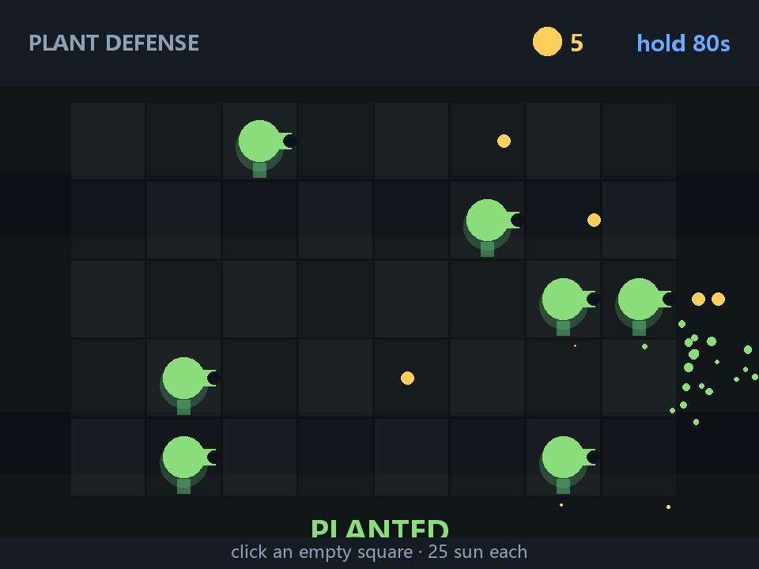 |

| 六边方块 | 炸弹人 | 小鳄鱼洗澡 |
|---|---|---|
| 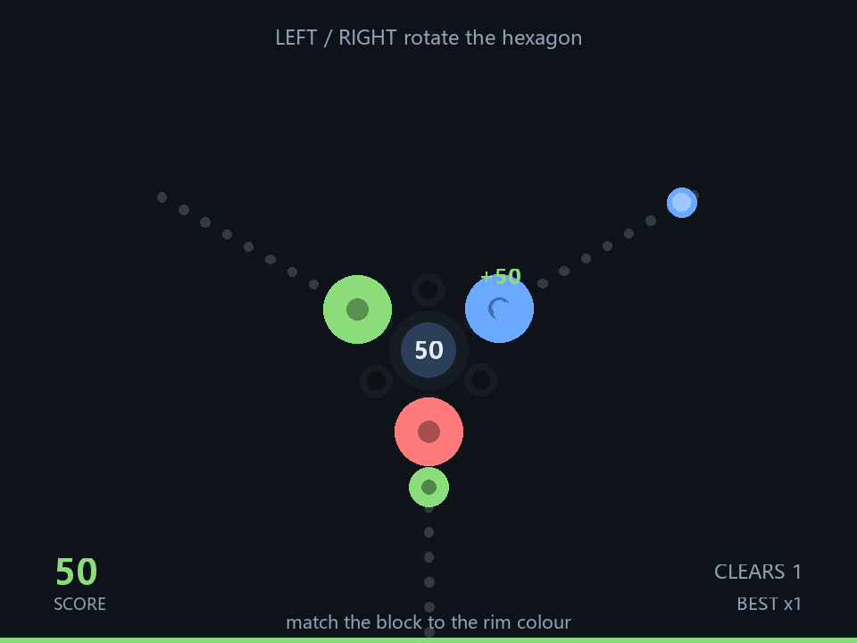 | 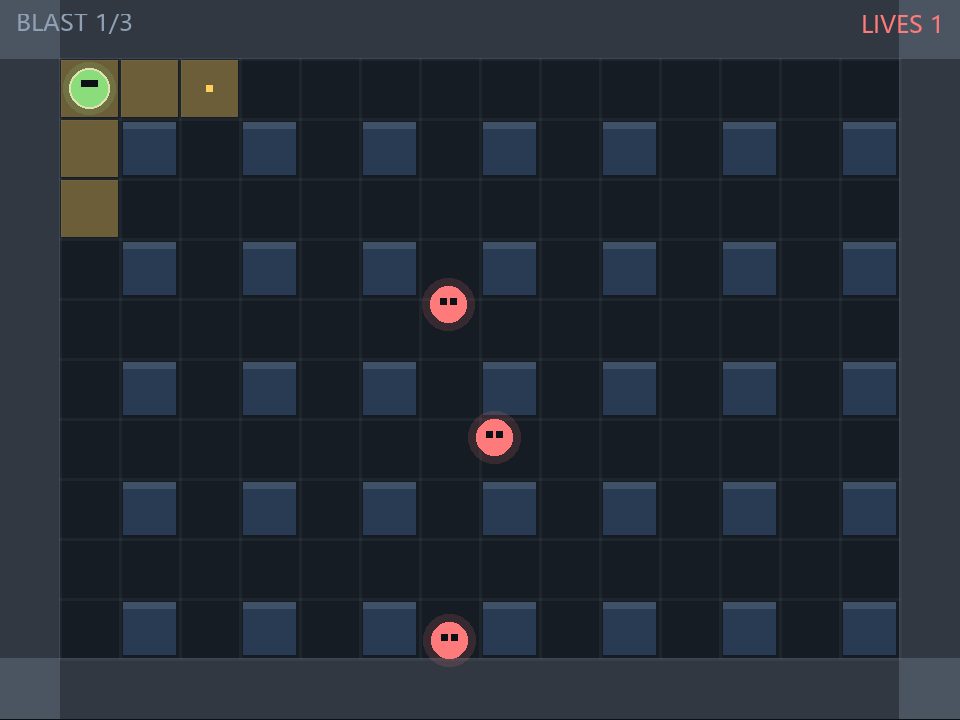 | 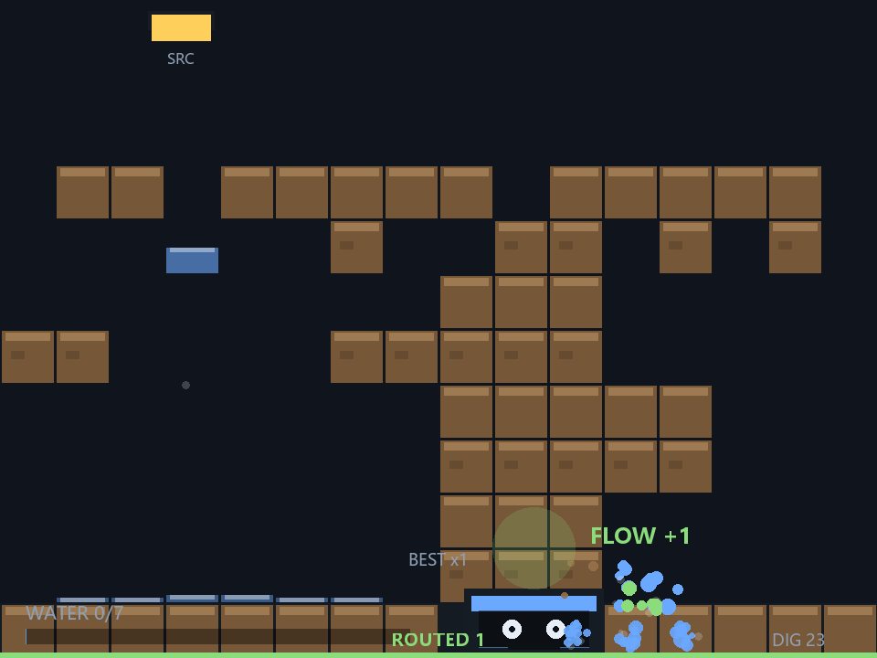 |

| 4×4 数独 | 纸牌接龙 | 涂鸦跳跃 |
|---|---|---|
| 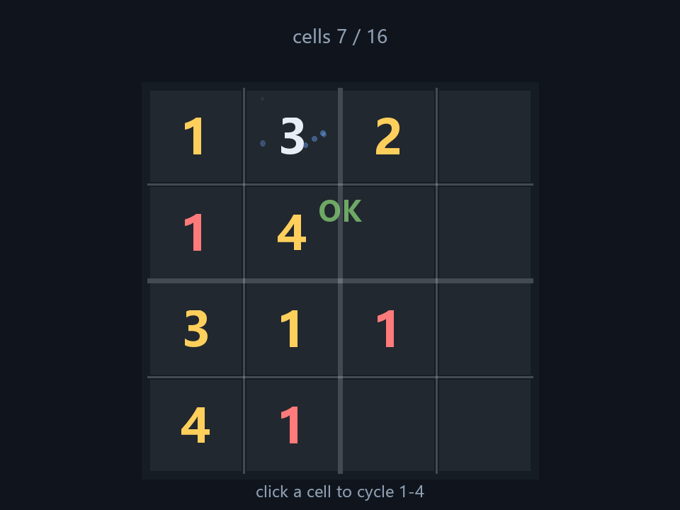 | 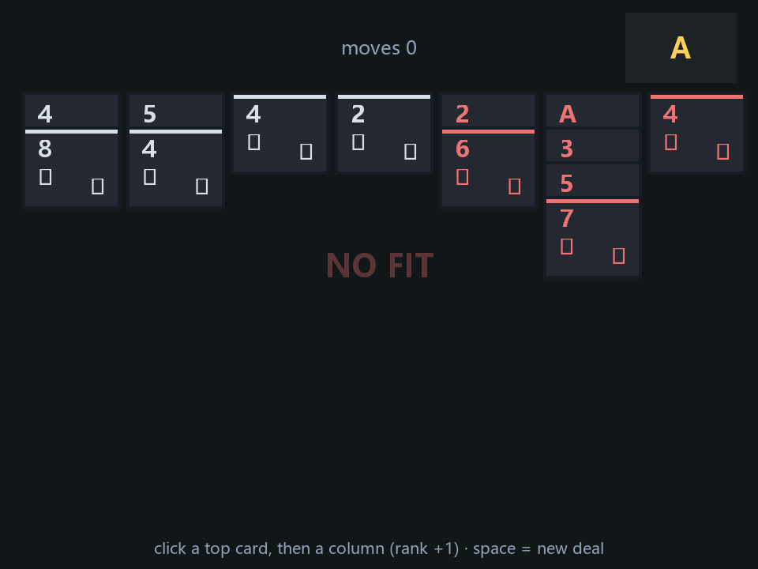 | 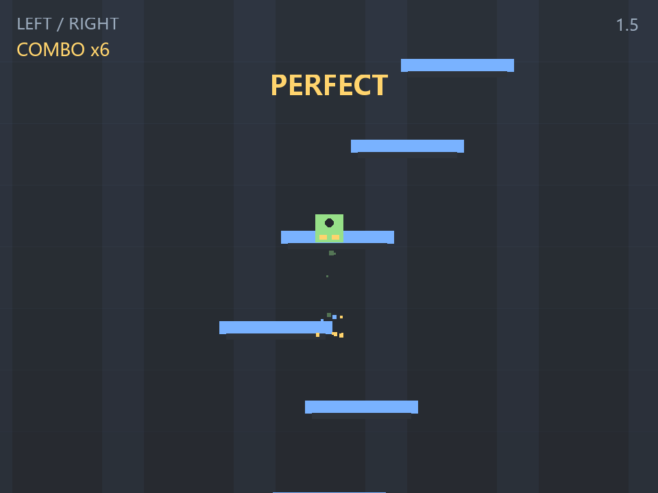 |

3D 组（自带 WebGL 层，离线透视投影渲染）：

| 神庙逃亡 | 阿尔托的冒险 | 地铁跑酷 | 玻璃冲击 |
|---|---|---|---|
| 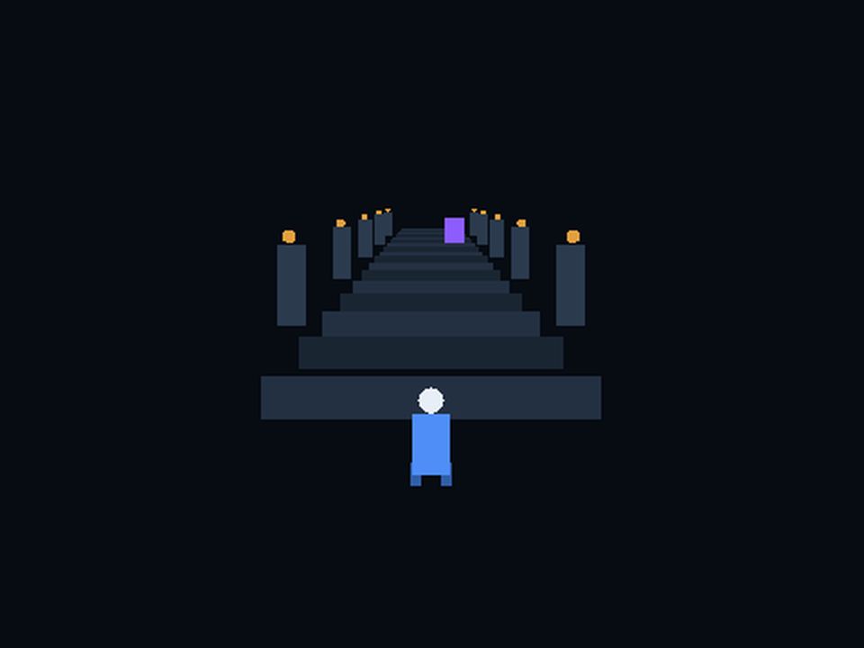 | 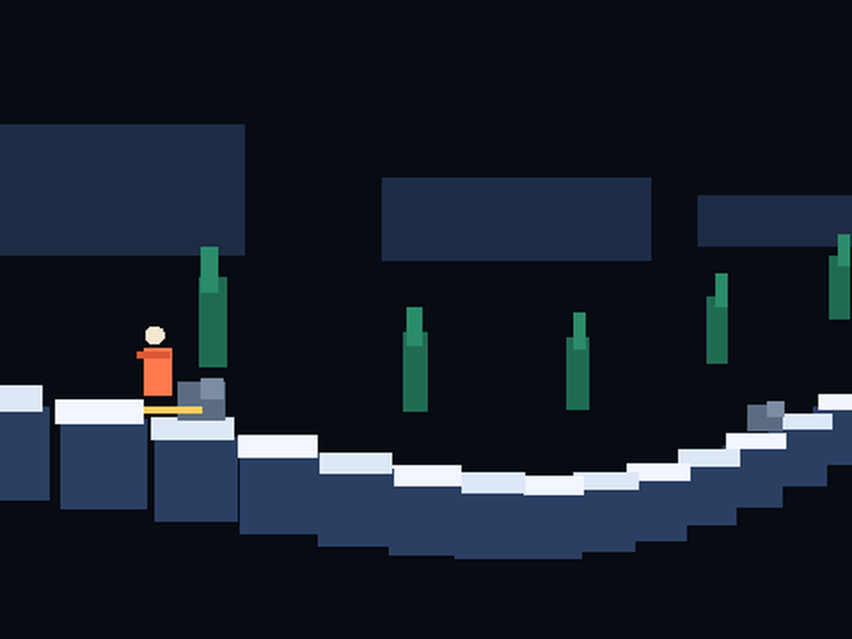 | 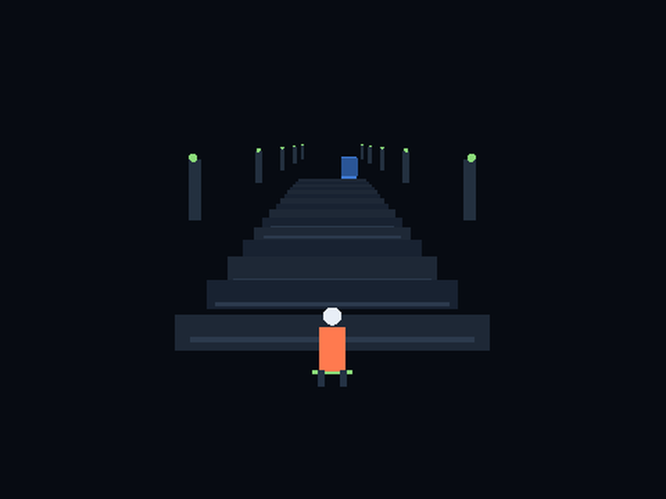 | 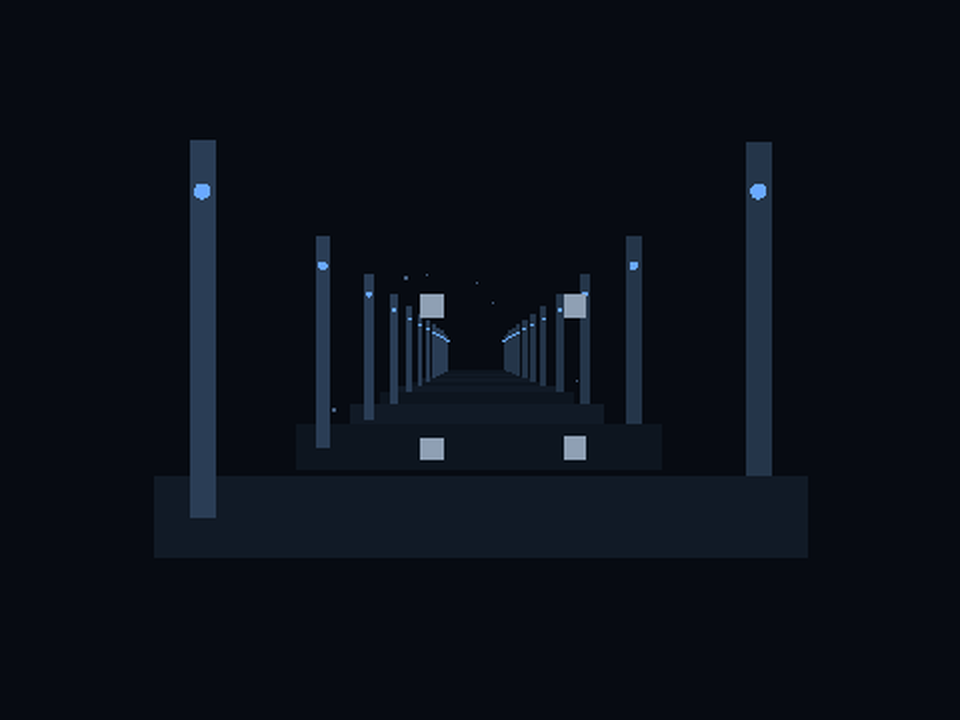 |

## 安装

插件以 **bundle** 形式提供（`bundles/dsh-together`，包名 `@hjdd14/dsh-together`）。

```text
# 在 Harness 里安装（指向这个目录，链接安装，不会复制）
plugin_manager  install_bundle  D:\path\to\dsh-worktogether!!!\bundles\dsh-together
```

装好后：

1. 刷新一次 Web 界面（`Ctrl+F5`）；插件行在设置里可见；
2. **设置 → 工作中小游戏**，确认「启用拦截图游戏」开着、分类勾上、冷却时间按喜好设；
3. 让 Agent 改任意文件 —— 浮层弹出，过关后它继续。

> 插件自带客户端资源，无需构建步骤；`bundles/dsh-together/lib/client.js` 已经是产物。

## 设置

设置页所有项即时保存到 `~/.dsh/dsh-together.json`：

| 项 | 默认 | 说明 |
|---|---|---|
| 启用拦截图游戏 | 开 | 总开关 |
| 冷却时间 | 60s | 通关后这段时间内的写操作直接放行 |
| 难度 | 宽松 | 宽松 ×0.7 / 标准 ×1 / 严格 ×1.3（只改门槛倍率） |
| 一次几局 | 1 | 1–3 局连玩，全过才放行 |
| 不重复窗口 | 12 | 最近 N 个游戏不再出现；`0` 仍保证不连续重复 |
| 单局时限 | 90s | 超时算一次失败（3 次失败自动放行） |
| 拦截 Shell | 开 | `rm` / `sed -i` / 重定向 / `node -e` 等写操作也拦 |
| 允许换一局 | 开 | 浮层上的「换一个游戏」 |
| 测试放行后门 | 开 | 浮层左下角「测试放行」，不记分、不冷却 |
| 无浏览器时放行 | 关 | 关着更安全：宁可多拦一次，也不静默放过 |

设置页顶部还有一个**拦截器自检**圆点：绿=已生效，黄=已挂载待验证；旁边两个按钮
「验证拦截」「看一个 3D 游戏」可以直接调起一局确认链路。

## 游戏库

194 个，10 个分类（名字见 [games/](bundles/dsh-together/client-src/games)）：

| 分类 | 数 | 代表 |
|---|---:|---|
| 经典街机 | 27 | 贪吃蛇、俄罗斯方块、打砖块、太空侵略者、青蛙过河、炸弹人、蜂群射击、划地者 |
| 跑酷闪避 | 18 | 小恐龙、小鸟穿管、涂鸦跳跃、地铁换道、隧道冲刺、熔岩攀爬 |
| 益智拼图 | 23 | 2048、扫雷、接水管、数独、纸牌接龙、麻将连连看、华容道堵车、一笔画 |
| 手速反应 | 18 | 打地鼠、切水果、停表、卡点开锁、见招拆招、切线瞄准 |
| 文字算术 | 18 | 打字冲刺、猜词、摩斯点击、数点、单词接龙、迷你填字、字母解密 |
| 棋牌对局 | 16 | 井字棋、黑白棋、五子棋、跳棋、21 点、海战、骨牌接龙、一步杀 |
| 节奏弹幕 | 19 | 节奏点击、钢琴块、弹幕地狱、激光网格、太鼓、吉他英雄 |
| 物理弹跳 | 17 | 叠方块、投石机、保龄球、多米诺、弹弓拆塔、抓娃娃 |
| **立体 3D** | **14** | 立体塔防、立体打砖块、立体赛车、神庙逃亡、地铁跑酷、纪念碑谷 |
| **复古手机** | **24** | 弹球闯关、太空侵略、播种棋、泡泡龙、祖玛、水果忍者、割绳子、涂鸦跳跃 |

每个游戏都有一行中英玩法说明，由宿主随挑战一起下发；门槛由 catalog 决定，游戏只报进度。

## 原理

```text
Agent 调用 write / edit / bash …
      │
      ▼
tools/pre-execute  ← 插件挂在**根作用域**（所有分发的祖先），不会漏
      │  分类器判断：是不是文件类写操作？
      ├─ 否 → allow
      └─ 是 → 冷却外？→ 抽一局（避开最近的游戏）→ 挂起 Promise
                                    │
                      浏览器浮层 ◄──┘  GET /x-together/state 轮询
                             │
                    玩家过关 → POST /x-together/complete（宿主校验分数 ≥ 门槛）
                             │
                    Promise 兑现 → allow → 工具真正执行
```

- **永不悬空**：插件卸载、会话结束、调用中止、3 次游戏故障，都会让等待中的调用有明确结局。
- **分数由宿主裁决**：游戏只能 `api.progress(n)` / `api.score(n)`，不能自己宣布胜利。
- **状态文件**：`~/.dsh/dsh-together.json`（设置）+ `~/.dsh/dsh-together.state.json`（轮换池）。

## 开发

```bash
# 打包客户端（把 194 个游戏内联进 lib/client.js）
node build.mjs            # 或 node build.mjs --check 只校验

# 全量测试（243 项）
node --test test/gate.test.mjs        # 状态机 / 分类器         19
node --test test/history.test.mjs     # 不重复抽题 / 持久化      8
node --test test/play.test.mjs        # 独立播放页              5
node --test test/games.smoke.test.mjs # 194 个游戏契约 + 600 帧 200
node --test test/audit.test.mjs       # 行为审计（可玩性/无敌判定）7
node --test test/bundle.test.mjs      # 产物可被 Harness 加载     4
```

**行为审计**是这里最有意思的一层：它不看代码，只跑游戏并检查结果——
零输入时 `survive` 类必须失败、`count/score` 类不得自己达标、画布上至少 5% 的绘制要落在可视区、
声明了失败的游戏必须真的能失败。上线前它抓到过「障碍永远撞不到玩家」「站着不动就通关」这类恶性 bug。

### 加一个游戏

1. 在 `shared/catalog.js` 的 `GAMES` 里加一行（id、分类、门槛、中英名、一句话玩法），并在 `HOW_TO` 里加中英说明；
2. 新建 `client-src/games/<分类>/<id>.js`：

```js
defineGame({
  id: 'snake',
  create(api) {
    return {
      update(dt) { /* 逻辑，dt 秒 */ },
      draw(g) { api.clear(); api.rect(10, 10, 20, 20, api.colors.accent) },
    }
  },
})
```

3. `node build.mjs && node --test test/games.smoke.test.mjs`。

约束（由测试强制）：不引入任何三方库、不用 `Math.random`（用 `api.rng`）、不用定时器、
不自判胜负、单文件 2D ≤300 行 / 3D ≤340 行。

### 3D 游戏

`mode: '3d'` 的游戏拿到 WebGL 上下文和一层渲染助手：

```js
api.gl3d.camera({ eye: [0, 6, 12], target: [0, 1, 0] })
api.gl3d.draw(api.gl3d.mesh('box'), { x, y, z, ry, s: 1.2 }, '#4f8ef7')
```

不引 three.js 的原因：本客户端模块表只解析平台 seed 与 boot graph 里的包行，
第三方库既不在图里也没有可用的 URL 加载路径；自建层零依赖、能被测试桩驱动。

### 单独看某个游戏

不想打开宿主界面时，请求这两个只读路由即可（同源、无需外壳）：

```text
/x-together/play?game=<2D 游戏 id>      例：?game=lanesdodge
/x-together/play3d?game=<3D 游戏 id>    例：?game=templerun
```

## 目录

```text
bundles/dsh-together/
├── index.js            宿主入口：拦截、路由、生命周期
├── host/               gate 状态机 / 分类器 / 设置 / 轮换 / 独立播放页
├── client-src/         core.js（引擎+浮层+设置页）与 194 个游戏
├── shared/             catalog（唯一事实源）+ gl3d（3D 渲染层）
├── lib/client.js       构建产物（Harness 直接加载）
├── test/               243 项测试
└── docs/3d/            3D 场景离线渲染图
tools/                  shot.mjs / render.py：把游戏的绘制调用渲染成 PNG
docs/screenshots/       README 用的截图
```

> 想了解更细的机制（分类器规则、路由表、设置项语义），见
> [bundles/dsh-together/README.md](bundles/dsh-together/README.md)。

## 已知边界

- 单 bundle 内联全部游戏，产物约 1.45 MB；继续扩容应拆第二个 bundle。
- 3D 游戏需要 WebGL；没有时显示提示并按一次故障上报（3 次自动放行）。
- 极少数游戏的机器人复验偏快（弹球闯关、割绳子），真人体验约 15–25 秒；门槛在 catalog 里可调。
- 不联网、不上传、不采集任何数据；游戏画面与状态全部留在本机。
